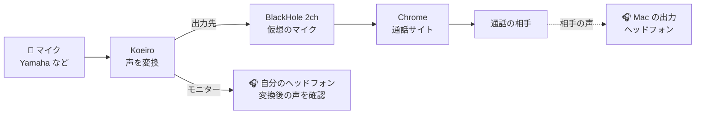
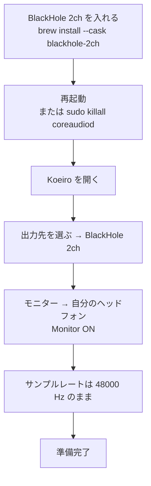
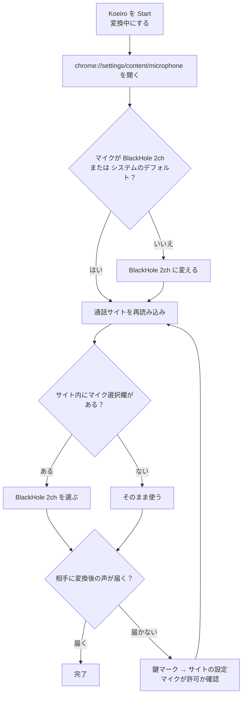
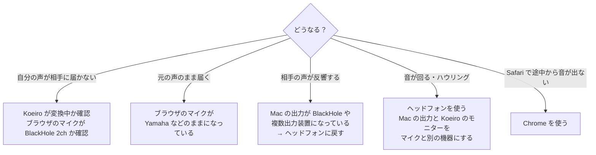

# Mac で通話アプリ・ブラウザに声を送る

Koeiro で変えた声を、ブラウザの通話サイト（例: [potalk.app](https://potalk.app/)）に送るための設定です。
フローチャートは、そのまま上から順にたどれます。

> **おすすめ: ブラウザ通話は Chrome を使う。**
> Chrome では、この手順で安定して動くことを確認しています。
> Safari では、通話を始めてしばらくすると、声が途切れたり、入力が下がったりすることがありました（ブラウザの音声処理が、仮想マイクの声を雑音やエコーと見なすためと考えられますが、原因は確認できていません）。

---

## 1. 音の流れ（全体像）

ポイントは3つだけです。

- **Koeiro の出力先** は「BlackHole 2ch」
- **自分の耳で確認する音** は、Koeiro の「モニター」で、ヘッドフォンを選ぶ（Monitor ON）
- **ブラウザのマイク** は「BlackHole 2ch」

複数出力装置（Audio MIDI 設定）は、**作らなくて大丈夫**です。

---

## 2. 最初に一度だけ（準備）

---

## 3. Chrome で使う

Chrome は、**前に選んだマイクを覚えている**ことがあります。Mac の入力を変えても、Chrome 側が元のマイクのままだと届きません。

届いているか確認する、いちばん簡単な方法は、**「システム設定 → サウンド → 入力」で BlackHole 2ch を選び、話して、入力レベルのバーが動くか見る**ことです。動けば、Koeiro から BlackHole までは、つながっています。

---

## 4. うまくいかないとき

| 症状 | 確認すること |
|---|---|
| 届かない | Koeiro が「変換中」か。ブラウザのマイクが `BlackHole 2ch` か |
| 元の声のまま | ブラウザのマイクが Yamaha などのままになっていないか |
| 相手の声が反響する | Mac の出力を、BlackHole や複数出力装置にしていないか（ヘッドフォンにする） |
| 音が回る | 返ってきた声を、スピーカーで聞いていないか。Mac の出力とモニターが、マイクと同じ機器（Yamaha など）になっていないか |
| 音が小さくなる | コントロールセンター → マイクモード → 「標準」 |
| Safari で途切れる | Chrome を使う |

---

## メモ

- BlackHole に入る音は、**Koeiro の出力だけ**にします。Mac の出力を BlackHole や複数出力装置にすると、相手の声まで BlackHole に入って、相手に戻ります。
- 通話の相手の声は、BlackHole からは聞こえません。聞くための出力（ヘッドフォンなど）は、Mac の出力に別に選びます。
- モニターは、自分の耳で確認するための**コピー**です。多少の途切れは仕様で、通話の相手に届く音（BlackHole 側）には影響しません。
- 変換後の声は、約 2 秒遅れます（AI 変換の特性です）。
- 使い方全般は [USAGE_MAC.md](USAGE_MAC.md) を見てください。
