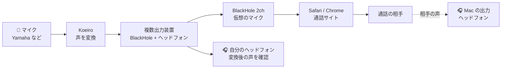
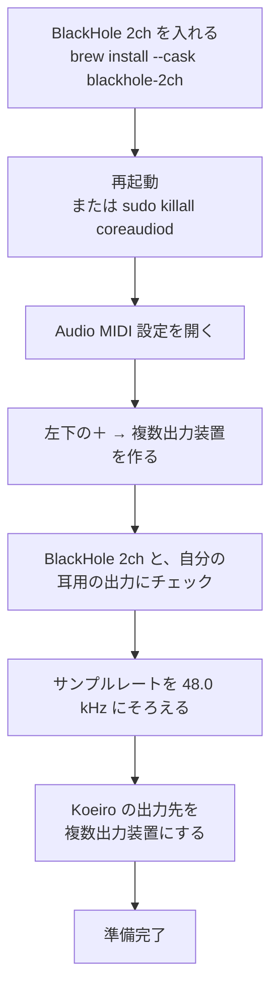
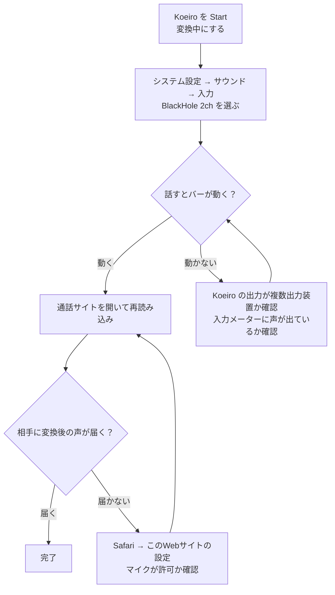
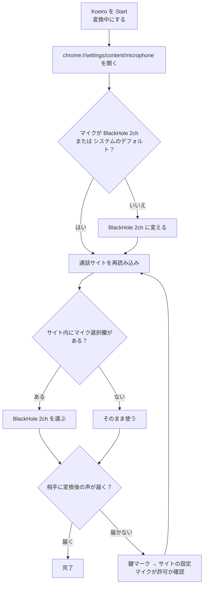
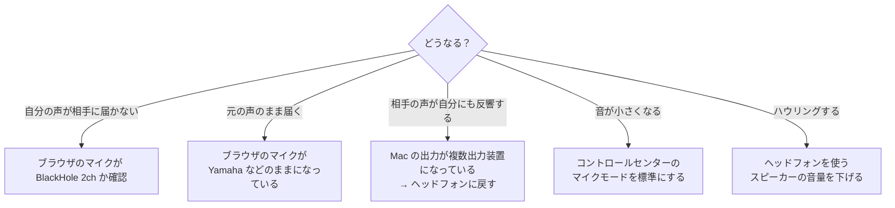

# Mac で通話アプリ・ブラウザに声を送る（Safari / Chrome）

Koeiro で変えた声を、ブラウザの通話サイト（例: [potalk.app](https://potalk.app/)）に送るための設定です。
フローチャートは、そのまま上から順にたどれます。

---

## 1. 音の流れ（全体像）

ポイントは2つだけです。

- **Koeiro の出力先** は「複数出力装置」（BlackHole 2ch ＋ 自分の耳用の出力）
- **ブラウザのマイク** は「BlackHole 2ch」

---

## 2. 最初に一度だけ（準備）

---

## 3. Safari で使う

Safari は、**Mac の「入力」に選ばれているマイク**を使います（サイトごとの選択欄がない場合）。

---

## 4. Chrome で使う

Chrome は、**前に選んだマイクを覚えている**ことがあります。Mac の入力を変えても、Chrome 側が元のマイクのままだと届きません。

---

## 5. うまくいかないとき

| 症状 | 確認すること |
|---|---|
| 届かない | ブラウザのマイクが `BlackHole 2ch` か。Koeiro が変換中か |
| 元の声のまま | ブラウザのマイクが Yamaha などのままになっていないか |
| 相手の声が反響する | Mac の出力を「複数出力装置」にしていないか（ヘッドフォンにする） |
| 音が小さくなる | コントロールセンター → マイクモード → 「標準」 |
| ハウリング | ヘッドフォンを使う。スピーカー出力は避ける |

---

## メモ

- BlackHole に入る音は、**Koeiro の出力だけ**にします。Mac の出力を「複数出力装置」にすると、相手の声まで BlackHole に入って、相手に戻ります。
- 通話の相手の声は、BlackHole からは聞こえません。聞くための出力（ヘッドフォンなど）は、Mac の出力に別に選びます。
- 変換後の声は、約 2 秒遅れます（AI 変換の特性です）。
- 使い方全般は [USAGE_MAC.md](USAGE_MAC.md) を見てください。
