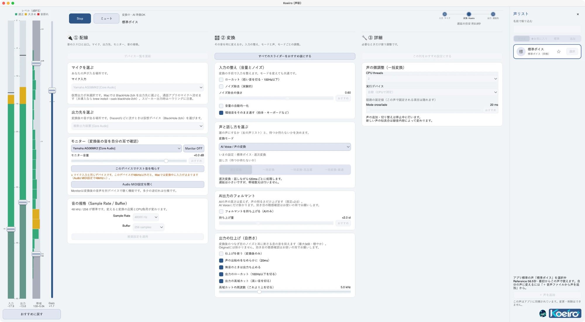

<p align="center">
  <a target="_blank" rel="noopener noreferrer" href="assets/icon.png">
    
  </a>
</p>

<h1 align="center">Koeiro（声彩）</h1>

<p align="center">
  <strong>登録した声へリアルタイムに変換する次世代ローカルAIボイスチェンジャー</strong><br>
  Windows 10/11 & Linux 対応 ｜ MeanVC2 + LavaSR 帯域復元 ｜ 環境音はそのまま通す ｜ Discord RPC 連携 ｜ 低スペック・CPU環境対応
</p>

<p align="center">
  <a href="https://negix.booth.pm/items/8981333"></a>
  
  
  
  
</p>

> 🍎 **非公式の Mac（Apple Silicon）版**: 本家 [heynegix/koeiro](https://github.com/heynegix/koeiro)（MIT License、v0.13.5 ベース）のフォークです。本家の作者とは別の人が、個人で作っている非公式の対応です。名前・ロゴ・標準ボイスは、本家の作者の許可を得て使っています。
>
> - **ダウンロード（アプリ）:** [Releases の Koeiro-mac-0.13.5.zip](https://github.com/riryo3/koeiro-mac/releases/tag/v0.13.5-mac5) を解凍して、右クリック → 開く。初回だけ、約 2GB の準備があります（試作版）。
> - 使い方: [USAGE_MAC.md](USAGE_MAC.md) ／ 入れ方と変更点: [MAC.md](MAC.md) ／ ブラウザ通話に使う（Chrome 推奨）: [AUDIO_MAC.md](AUDIO_MAC.md)
> - 本家への Mac 対応の提案は、[PR #4](https://github.com/heynegix/koeiro/pull/4) で進んでいます（このフォークとは別です）。
> - **テストについて:** 画面を3列のレイアウトに作り替えたため、本家の画面（右から重なる設定パネル）を前提にした自動テスト（`tests/test_ui_flow.py` など）の一部は、このフォークでは通りません。画面そのものは、動作を確認しています。
> - このフォークの変更は、AI（Claude）の支援を受けて作りました。Mac mini (M4) と MacBook (M1、8GB) の実機（CPU のみ）で動作を確認しています。画面のレイアウトの変更は個人の好みによるもので、本家のデザインへの批判ではありません。

<p align="center">
  
  <br>
  <sub>Mac 版の画面。左端に、入力・出力・帯域・ゲインのメーターがあります（Mac mini M4、標準ボイス、逐次変換）。</sub>
</p>

---

## 📖 概要

**Koeiro（声彩 / こえいろ）** は、マイクから入力された音声をリアルタイムで目的の声へと変換するローカル動作型AIボイスチェンジャーです。

超軽量な音声変換モデル **MeanVC2** に加え、高品質な超解像・帯域復元技術 **LavaSR** を統合。配信（OBS）、通話（Discord / Zoom）、VRChat などのVRメタバースに向けて、低遅延かつクリアなボイス変換を提供します。音声データは外部サーバーへ送信されず、すべてお使いのPCローカル環境で完結します。

GUIとAI推論ワーカーを独立したプロセスとして分離するアーキテクチャを採用しており、GUI側の軽快なレスポンスとAI推論の安定動作を両立。GPU非搭載のミニPC（Intel N100 / N150等）やCPU環境でも実用的に動作するよう、CPU 経路を実測して最適化しています。

---

## 🚀 インストール & クイックスタート

### 🌟 【一番おすすめ】BOOTH版（ワンクリック簡単導入）

Pythonのインストールやコマンド操作なしですぐに使いたい方は、**BOOTH版のインストーラー**の利用を推奨します。

👉 **[BOOTH 配布ページはこちら（negix.booth.pm/items/8981333）](https://negix.booth.pm/items/8981333)**

- **Windows**: ダウンロードした `setup.exe` を実行してアプリを導入し、続けて AI パック（`ai-pack.exe`）をインストールすると AI ボイスが使えます。標準のインストール先は `%LOCALAPPDATA%\Programs\Koeiro` です。
- **Linux**: 配布アーカイブを展開後、同梱の `install-ai-pack.sh` を実行して起動します。
- 初めてAIボイスチェンジャーを触る方や、手軽に配信・通話で使いたい方に最適です。

---

### 📦 GitHub Releases 版（実行ファイル / 手動セットアップ）

[Releases](https://github.com/heynegix/koeiro/releases) には、Python 不要の**実行ファイル版**と、Python 3.12 で動かす**ソースツリー版**が添付されています。

- **実行ファイル版**: Windows は `koeiro-vX.Y.Z-windows-setup.exe` を入れてから AI パック（`-ai-pack.exe` と `-1.bin`）を入れます。Linux は `-linux-app.tar.gz` を展開し、`install-ai-pack.sh` で AI パックを入れます。どちらも `-checksums.txt` で破損を確認できます。
- **ソースツリー版（手動セットアップ）**: `koeiro-vX.Y.Z-windows.zip` / `-linux.tar.gz` を展開し、以下の手順で初回セットアップします。

#### Windows の場合
1. [Releases](https://github.com/heynegix/koeiro/releases) から `koeiro-vX.Y.Z-windows.zip` をダウンロードし、任意のフォルダ（※全角やスペースを含まない英数字パス推奨）に展開。
2. PowerShell を開き、展開先ディレクトリで初回セットアップを実行：
   ```powershell
   py -3.12 tools/setup_release.py
   ```
3. セットアップ完了後、アプリを起動：
   ```powershell
   .\.venv\Scripts\python app.py
   ```

#### Linux の場合
1. [Releases](https://github.com/heynegix/koeiro/releases) から `koeiro-vX.Y.Z-linux.tar.gz` をダウンロードして展開。
2. ターミナルで依存パッケージの導入と初回セットアップを実行：
   ```bash
   # PySide6 の実行ライブラリ（libgl1 等）も含めてインストール
   sudo apt install -y libportaudio2 portaudio19-dev ffmpeg \
       libgl1 libegl1 libglib2.0-0 libxkbcommon0 libdbus-1-3 fontconfig
   python3.12 tools/setup_release.py
   ```
3. セットアップ完了後、アプリを起動：
   ```bash
   .venv/bin/python app.py
   ```

> [!TIP]
> アプリ起動後は「調整」引き出しの **「① 配線」** で **入力デバイス（マイク）** と **出力デバイス（VB-CABLE やヘッドホン等）** を指定してください。Discord や OBS 側では、Koeiro の出力先と同じ仮想オーディオデバイスを入力として選択します。

---

## ✨ 主な機能

* **用途に合わせた変換モード**
  * **逐次変換（Streaming）**: 発話しながらリアルタイム・低遅延に変換。通話やゲームプレイに最適。
  * **一括変換（LavaSR 高音質）**: 無音区間（約0.8秒）で自動分割し、文全体を一括変換後に LavaSR で高域を復元。極めて自然で明瞭な音質を実現。
  * **一括変換 - 最速**: 判定待ち時間を約0.6秒まで短縮し、レスポンスを最優先したバッチ変換。
  * **一括変換 - 高品質**: 上流 CLI と同じ全体補間・ノイズで条件付けし、ソルバーのステップを増やした品質優先ルート（変換に時間がかかります）。
  * **Original / Female DSP**: AIを介さない素通し（スルー）モード、および軽量DSPによるピッチ・フォルマント加工。
* **環境音はそのまま通す（拍手・キーボード・物音）**
  * 変換モデルを通すと別の音に化けてしまう一過性の環境音を、変換せずそのままの音でリスナーへ届けます。逐次変換・一括変換の両方で働き、既定で ON（「調整」の「環境音をそのまま通す」で切り替えできます）。
  * 咳・鼻すすり・くしゃみなど声まわりの音は環境音とみなさず、これまでどおり変換します。
* **声の登録 & 切り替え**
  * 標準で参照ボイスを同梱。目的の声の音声クリップ（wav/mp3等）を追加することで、お好みのキャラクターボイスへの変換が可能（※自作ボイスモデルの追加生成には開発環境が必要です）。
* **Discord Rich Presence（RPC）連携**
  * Discord のステータスに「Koeiro で変換中」「使用中のボイス名」をリアルタイム表示。
* **CPU 実測最適化 & GPU（CUDA）自動切替**
  * GPU 非搭載のミニPC（Intel N100 / N150 等）でも動く CPU 経路を既定に設計。
  * NVIDIA GPU が検出された場合は、実測済みの MeanVC2 で CUDA を自動選択（「CPU」で固定も可能）。GPU 経路は Kaggle の Tesla T4 で CPU と -76 dB まで一致、2.0〜2.7 倍速を確認済みです。TF32 を制御して推論の再現性を確保。
* **洗練されたUI設計（ステージ1枚＋引き出し）**
  * メイン画面は入力レベル・遅延・ステータス表示に集中。詳細設定は「調整」「実験」の引き出しに収納。
  * 初回起動時のスポットライトガイドや、GitHub Releases と連携したアプリ内ワンクリック自動アップデートに対応。
* **話し方の演出・オーディオ処理**
  * **感情・抑揚プリセット**: Calm / Gentle / Energetic / Sad / Anime Light / Anime Expressive / Feminine 等を搭載。
  * **入力の整え（音量の自動均一化）**: 小声をAIが認識しやすい音量へ自動リフト（無音区間は増幅しません）。
  * **出力の仕上げ & ノイズ除去**: つなぎ目のアーティファクトや耳に刺さる息音を穏やかに抑制。
  * **AI出力フォルマント**: ピッチを維持したまま声の共振を高域へ寄せ、明るい声色に補正。
* **配信・通話を加速するショートカット**
  * **シーン機能**: マイク、ボイス、配線、エフェクトをプロファイルとして保存・瞬時呼出。
  * **ホットキー**: `Ctrl+1/2/3` でモード変更、`Ctrl+D` で Original ↔ 直前変換をトグル。
  * **音声コマンド（β）**: ウェイクワード「コエイロ」＋「止めて」「次の声」などのローカル音声操作。
* **拡張パック（DLC）& 実験機能**
  * レイテンシ・ガバナ、囁き検出モード、LAN内GPUを活用する分散推論、話者自動振り分け、Kokoro-82M による音声合成（TTS、モデルは `python tools/install_tts.py` で取得）などを搭載。

---

## 🛠️ 動作要件

| 項目             | 要件                                                                                                                              |
| :------------- | :------------------------------------------------------------------------------------------------------------------------------ |
| **OS**         | Windows 10 / 11 (64bit), Linux (Debian 12 / Ubuntu 22.04+ 推奨)                                                                   |
| **Python**     | 3.12 系（ソース実行・Releases版手動セットアップ時）                                                                                                |
| **CPU**        | 4スレッド以上のマルチコアCPU（Intel N100 / N150 等でリアルタイム動作確認済み）                                                                              |
| **GPU**        | 不要（CPUのみで動作可能）。NVIDIA GPU（CUDA 12）搭載環境ではさらに高速動作                                                                                 |
| **メモリ**        | 4GB 以上（AI推論ワーカープロセス実測: 約0.9GB）                                                                                                  |
| **ストレージ**      | 8GB 以上の空き容量（モデル・仮想環境含む）                                                                                                         |
| **外部ツール**      | **FFmpeg**（音声処理用）、**git**・**uv**（ソースツリー版の初回セットアップで使用）、**仮想オーディオデバイス**（VB-CABLE、VoiceMeeter 等）                                           |
| **Linux 追加依存** | `libportaudio2`, `portaudio19-dev`, `ffmpeg`, `libgl1`, `libegl1`, `libglib2.0-0`, `libxkbcommon0`, `libdbus-1-3`, `fontconfig` |

---

## 🎙️ 仮想オーディオデバイスとの接続例（Discord / OBS）

通話アプリや配信ソフトに変換後の声を出力するには、仮想オーディオドライバ（VB-CABLE 等）を利用します。

```
[物理マイク] ──> 【Koeiro 入力】 ──(AI変換)──> 【Koeiro 出力（CABLE Input）】
                                                        │
                                                        ▼
                                       【Discord / OBS 入力（CABLE Output）】
```

1. Koeiro 側の設定:
   - 入力デバイス: お使いのヘッドセット・マイク
   - 出力デバイス: CABLE Input (VB-Audio Virtual Cable)
2. 通話・配信ソフト側の設定:
   - Discord / OBS などの音声入力デバイスに CABLE Output (VB-Audio Virtual Cable) を指定。
   - ご自身の声を確認（モニター）したい場合は、Koeiro の「モニター出力」機能でお使いのヘッドホン・スピーカーを選択してください。

---

## 🧪 ソースコードからの実行・開発

リポジトリをクローンして開発環境を構築する場合の手順です。初回セットアップのスクリプトが、GUI 用 `.venv` と AI ワーカー用 `vc_models/meanvc2/.venv` の作成、依存の導入、MeanVC2・LavaSR・環境音ゲートのモデル取得までをまとめて行います。

```bash
# 1. リポジトリのクローン（git と uv を使います）
git clone https://github.com/heynegix/koeiro.git
cd koeiro

# 2. 初回セットアップ (Python 3.12)
python3.12 tools/setup_release.py
#   Windows: py -3.12 tools\setup_release.py
#   uv が無い場合は先に: pip install uv

# 3. アプリケーションの起動
.venv/bin/python app.py
#   Windows: .\.venv\Scripts\python app.py
```

実行される処理の一覧だけ確認したい場合は `python3.12 tools/setup_release.py --dry-run` が使えます。GPU（CUDA）経路の計測手順は `notes/kaggle_gpu_verification.md` にあります。

---

## ❓ トラブルシューティング

各項目をクリックすると回答が開きます。

<details>
<summary>自分のPCに合う変換モードは？</summary>

CPUの性能に応じて変換モードを切り替えてみてください。低スペック環境では「一括変換 - 最速」が最も安定します。

</details>

<details>
<summary>音が途切れる・カクつくときは？</summary>

「調整」引き出しのバッファサイズ設定（フレーム数）を見直すか、バックグラウンドで動作している高負荷なプロセスを終了してください。

</details>

<details>
<summary>変換した声が Discord / OBS に届かない</summary>

「調整」引き出しの「配線」タブで、入力デバイスと出力デバイスが正しく割り当てられているか確認してください。通話・配信ソフト側では、Koeiro の出力に選んだのと同じ仮想オーディオデバイスの反対側（例: CABLE Output）を入力に指定します。

</details>

<details>
<summary>音が出ない・サンプルレートのエラーが出る（Windows）</summary>

Windowsのサウンド設定で、マイクおよび仮想オーディオデバイスのサンプリングレートが 48000 Hz (48 kHz) に設定されているか確認してください。

</details>

<details>
<summary>環境音（拍手・キーボードなど）の扱いを変えたい</summary>

「調整」の「環境音をそのまま通す」（既定 ON）で切り替えられます。咳・鼻すすりなど声まわりの音は環境音とみなさず変換されます。

</details>

<details>
<summary>Linux で起動しない（Qt のプラグインが見つからないなど）</summary>

PySide6（Qt）に必要な共有ライブラリが不足している可能性があります。以下が導入済みか確認してください:

```bash
sudo apt install -y libgl1 libegl1 libglib2.0-0 libxkbcommon0 libdbus-1-3 fontconfig
```

</details>

<details>
<summary>自作の声を追加できますか？</summary>

BOOTH配布のバイナリ単体にはモデル抽出スクリプトは含まれていません。自作ボイスの追加・特徴抽出を行う場合は、Python 3.12 / PyTorch 環境が整った開発環境（tools/ 配下のスクリプト）をご利用ください。

</details>

---

## 📜 ライセンス & クレジット

- Koeiro 本体: MIT License (c) 2026 Negix
- MeanVC2: Apache-2.0 License (ASLP-lab)
- LavaSR: Apache-2.0 License
- GUI Framework: PySide6 (LGPLv3)
- 詳細なサードパーティ製ライブラリおよび事前学習済みモデルのライセンスについては、THIRD_PARTY_NOTICES.md をご参照ください。

> [!WARNING]
> 第三者の音声を本人の許諾なく模倣・再現する行為、なりすまし、公序良俗に反する用途での使用は固く禁止します。倫理的な配慮のもとでご活用ください。
